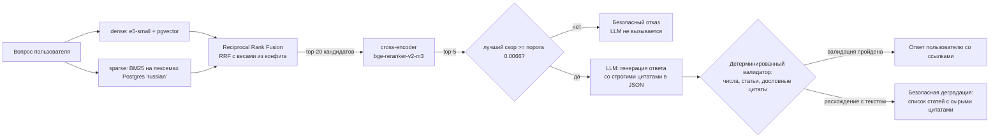

# Трудовой кодекс РФ: гибридный RAG с честной оценкой

[](https://github.com/DelixeamI/hybrid-rag/actions/workflows/ci.yml)
[](LICENSE)
[](pyproject.toml)
[](tests)
[](https://github.com/astral-sh/ruff)
[](https://mypy-lang.org/)

Сервис ответов на вопросы по Трудовому кодексу РФ обычным языком: коротко, со ссылками на статью, часть и цитату, либо с честным отказом от генерации, если в кодексе ответа нет.

> **Главный фокус проекта:** Не написание «красивых промптов», а измеримая инженерная оценка: Recall@k, MRR, калибровка порога отказа на внедоменных вопросах, детерминированная проверка grounding и воспроизводимые кассетные тесты в CI/CD без платных API.

---

## 1. Проблема
В юридических и регуляторных задачах стандартный наивный RAG (простой семантический поиск по косинусному расстоянию + LLM) приводит к критическим ошибкам бизнеса:
1. **Галлюцинации и конфабуляция статей:** LLM уверенно выдумывает несуществующие статьи и приписывает нормам неверные сроки и штрафы.
2. **Отсутствие безопасного отказа (Abstention failure):** На вопросы не по теме (или вопросы с ложной пресуппозицией) модель пытается сгенерировать правдоподобный ответ вместо честного отказа.
3. **Хрупкость ретривала:** Чисто векторный поиск плохо ищет точные номера статей, числительные и юридические термины, а чистый лексический поиск (BM25) теряет синонимы и перефразировки.

---

## 2. Решение
1. **Двухконтурный гибридный поиск:** Объединение плотных векторов (`multilingual-e5-small` в `pgvector`) и разреженного полнотекстового поиска BM25 (на лексемах PostgreSQL `russian`) через ранговое слияние Reciprocal Rank Fusion (RRF, top-20).
2. **Cross-Encoder реранкинг:** Модель `bge-reranker-v2-m3` отбирает top-5 релевантных фрагментов, повышая Recall@5 с 80.3% до 90.8% и MRR с 0.696 до 0.816 на полном тексте ТК РФ.
3. **Калиброванный отказ от генерации:** Математически подобранный порог уверенности реранкера ($0.0066$) отсекает нерелевантные запросы до обращения к LLM.
4. **Детерминированный валидатор фактов и цитат (Grounding):** Синтаксическая сверка чисел, единиц измерения, статей и дословных цитат ответа с источником с безопасной деградацией до списка проверенных статей.
5. **Кассетный оффлайн-инференс (`RecordedLLM`):** Полный цикл CI/CD валидации качества работает автономно, быстро и без секретов.

---

## 3. Архитектура системы



*Чанкинг:* статья целиком (если короче ~500 токенов), длинные статьи делятся по частям с перекрытием в одну часть. У каждого фрагмента сохраняются breadcrumbs: `ТК РФ > Раздел > Глава > Статья`. Ингест строго идемпотентен по sha256 файла.

---

## 4. Стек технологий

| Компонент | Технологии |
|---|---|
| **Язык и среда** | Python 3.12, AsyncIO, uv |
| **API и сервисный слой** | FastAPI, Pydantic v2, Uvicorn, JSON-логирование |
| **База данных и поиск** | PostgreSQL 16 + pgvector, полнотекстовый поиск (FTS / BM25) |
| **Модели эмбеддингов и реранкинга** | `intfloat/multilingual-e5-small`, `BAAI/bge-reranker-v2-m3` |
| **Инференс LLM** | Локальная `qwen2.5:14b` (Ollama), OpenAI-compatible API, `RecordedLLM` кассеты |
| **Качество кода и тесты** | Pytest (141 тест), Mypy (strict), Ruff, Docker Compose |

---

## 5. Результаты и метрики (Evals)

Все метрики генерируются автоматически через `make eval` из `reports/*.json`. Руками не исправлено ни одной цифры.

### Оценка на полном тексте ТК РФ (`golden.jsonl`: 534 статьи, 710 чанков, 92 вопроса)
*Модель ответов: локальная `tkrag-qwen2.5-14b` через Ollama. Порог отказа реранкера: `0.0066`.*

| Режим ретривала | Recall@1 | Recall@5 | Recall@10 | MRR | Latency p50, ms | Latency p95, ms |
|---|---|---|---|---|---|---|
| Postgres FTS (`ts_rank_cd`) | 19.7% | 39.5% | 46.1% | 0.251 | 10.8 | 139.3 |
| BM25 (Postgres lexemes) | 46.1% | 77.6% | 82.9% | 0.551 | 3.7 | 5.5 |
| dense (`multilingual-e5-small`) | 69.1% | 80.3% | 88.8% | 0.696 | 23.4 | 31.2 |
| **hybrid (dense + BM25, RRF)** | 71.1% | 84.9% | 88.8% | 0.727 | 27.7 | 33.5 |
| **hybrid + cross-encoder rerank** | **80.3%** | **90.8%** | **92.8%** | **0.816** | 397.6 | 476.2 |

#### Метрики генерации и надежности ответов:

| Метрика | Значение | Размер выборки (n) | Пояснение |
|---|---|---|---|
| **Корректные отказы на `no_answer`** | **100%** | 16 | Система не выдумала ответ ни на один внедоменный вопрос |
| **Ложные отказы на ответимых вопросах** | **0%** | 76 | Порог отсечения не заблокировал ни один реальный вопрос |
| **Подтверждённые ответы (Grounding)** | **93.4%** | 76 (71 из 76) | Числа, сроки и статьи дословно подтверждены текстом кодекса |
| **`answer_facts` recall (strict)** | **71.3%** | 76 | Лексическое совпадение ключевых фактов |

---

## 6. Демонстрация работы (CLI & API)

```
[Вопрос]: Какова продолжительность ежегодного основного оплачиваемого отпуска?
[Ретривал]: Найден фрагмент: ТК РФ > Глава 19 > Статья 115 (скор реранкера: 0.8941)
[Валидатор]: Проверка grounding: число '28', единицы 'календарных дней', статья '115' подтверждены.
[Статус]: OK (время обработки: 412 мс)

[Ответ]: Продолжительность ежегодного основного оплачиваемого отпуска составляет 28 календарных дней (ст. 115 ТК РФ).
[Цитата]: "Ежегодный основной оплачиваемый отпуск предоставляется работникам продолжительностью 28 календарных дней."
```

> 📷 **Скриншот работы Swagger UI и CLI:**  
> *(Заглушка: для записи GIF / скриншота выполните команду `make demo` в терминале с выводом цветного лога и откройте эндпоинт `http://127.0.0.1:8000/docs#/default/ask_ask_post`)*

---

## 7. Быстрый старт (Docker & uv)

Требуются **Python 3.12**, **Docker** и менеджер пакетов [uv](https://docs.astral.sh/uv/). API-ключи не нужны: система воспроизводит ответы из записанных кассет `RecordedLLM`.

```bash
# 1. Клонирование репозитория
git clone https://github.com/DelixeamI/hybrid-rag.git
cd hybrid-rag

# 2. Настройка окружения и зависимостей
cp .env.example .env
uv sync

# 3. Запуск PostgreSQL с pgvector в Docker
make up

# 4. Индексация корпуса и запуск валидации
make ingest   # парсинг, чанкинг и векторная индексация
make eval     # расчет метрик и прогон CI Quality Gates
make demo     # интерактивный запрос через консоль
```

API доступно по адресу: `http://127.0.0.1:8000`. Эндпоинты: `POST /ask`, `GET /health`.

---

## 8. Структура репозитория

```
hybrid-rag/
├── data/                    # Текст ТК РФ, проверенный golden.jsonl (92 вопроса)
├── migrations/              # Миграции структуры таблиц PostgreSQL и pgvector
├── reports/                 # Сгенерированные отчеты метрик (results_full.md, experiment_hybrid.md)
├── scripts/                 # Скрипты калибровки порогов, генерации вопросов и кассет
├── src/tkrag/
│   ├── api/                 # FastAPI роутеры (/ask, /health) и middleware латентности
│   ├── core/                # Конфигурация, Pydantic-схемы ответов и цитат
│   ├── eval/                # Модули расчета Recall@k, MRR, Grounding и отчетов
│   ├── ingest/              # Парсинг кодекса, расчет sha256, чанкинг с breadcrumbs
│   ├── llm/                 # Абстракция LLMClient (FakeLLM, RecordedLLM, OpenAICompatible)
│   ├── retrieval/           # Плотный e5, sparse BM25, Reciprocal Rank Fusion (RRF)
│   └── validation/          # Детерминированный валидатор чисел, статей и цитат
├── tests/                   # 141 автоматический unit- и интеграционный тест
├── DESIGN.md                # Архитектурные альтернативы, компромиссы и цена решений
├── docker-compose.yml       # Контейнер PostgreSQL 16 с расширением pgvector
└── pyproject.toml           # Зависимости и конфигурация uv / ruff / mypy
```

---

## 9. Ограничения и Roadmap (Что можно улучшить)

1. **Многоверсионность законодательства:** В текущей версии индексируется одна актуальная редакция кодекса. В roadmap: поддержка версионирования статей с фильтрацией по дате вступления в силу.
2. **Многостраничные регламенты и подзаконные акты:** Включение в корпус постановлений Пленума Верховного Суда РФ и писем Минтруда.
3. **GraphRAG:** Добавление графа связей между статьями для ускорения обработки комплексных перекрестных вопросов (`multi_article`).
4. **Контекст диалога:** Переход от single-turn `/ask` к поддержке сессионного контекста с учетом истории уточнений пользователя.

---
*Архитектурные детали и обоснование каждого решения: см. [DESIGN.md](DESIGN.md).*
