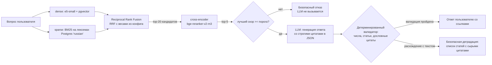

# Трудовой кодекс РФ: гибридный RAG с честной оценкой

[](https://github.com/DelixeamI/hybrid-rag/actions/workflows/ci.yml)
[](LICENSE)
[](pyproject.toml)
[](tests)
[](https://github.com/astral-sh/ruff)
[](https://mypy-lang.org/)

Сервис ответов на вопросы по Трудовому кодексу РФ обычным языком: коротко, со ссылками на статью, часть и цитату, либо с честным отказом от генерации, если в кодексе ответа нет.

> **Главный фокус проекта:** Не написание «красивых промптов», а измеримая инженерная оценка: Recall@k, MRR, калибровка порога отказа на внедоменных вопросах, детерминированная проверка grounding и воспроизводимые кассетные тесты в CI/CD без платных API.

---

## 1. Проблема
В юридических и регуляторных задачах стандартный наивный RAG (простой семантический поиск по косинусному расстоянию + LLM) приводит к типичным ошибкам (это мотивация проекта; наивный RAG как отдельная система здесь не измерялся, ближе всего к нему режим `dense` в таблице ниже):
1. **Галлюцинации и конфабуляция статей:** LLM уверенно выдумывает несуществующие статьи и приписывает нормам неверные сроки и штрафы.
2. **Отсутствие безопасного отказа (Abstention failure):** На вопросы не по теме (или вопросы с ложной пресуппозицией) модель пытается сгенерировать правдоподобный ответ вместо честного отказа.
3. **Хрупкость ретривала:** Чисто векторный поиск плохо ищет точные номера статей, числительные и юридические термины, а чистый лексический поиск (BM25) теряет синонимы и перефразировки.

---

## 2. Решение
1. **Двухконтурный гибридный поиск:** Объединение плотных векторов (`multilingual-e5-small` в `pgvector`) и разреженного полнотекстового поиска BM25 (на лексемах PostgreSQL `russian`) через ранговое слияние Reciprocal Rank Fusion (RRF, top-20).
2. **Cross-Encoder реранкинг:** Модель `bge-reranker-v2-m3` пересортирует top-20 кандидатов гибрида и оставляет top-5. В таблице ниже строка «hybrid + rerank» выше строки «hybrid» по Recall@5 и MRR; цена: задержка на порядок больше и нужен GPU.
3. **Отказ от генерации по порогу:** если лучший скор реранкера ниже порога, система отказывает, не обращаясь к LLM. Порог подобран на одной половине вопросов (DEV) и проверяется на другой (TEST); см. раздел «Результаты».
4. **Детерминированный валидатор (grounding):** сверка чисел с единицами, номеров статей и цитат ответа с процитированным текстом. Пересказанную моделью цитату он заменяет реальным фрагментом; не прошедший проверку ответ заменяется списком статей. Это проверка опоры на текст, а не юридической правильности.
5. **Кассетный оффлайн-инференс (`RecordedLLM`):** Полный цикл CI/CD валидации качества работает автономно, быстро и без секретов.

---

## 3. Архитектура системы



*Чанкинг:* статья целиком (если короче ~500 токенов), длинные статьи делятся по частям с перекрытием в одну часть. У каждого фрагмента сохраняются breadcrumbs: `ТК РФ > Раздел > Глава > Статья`. Ингест идемпотентен по отпечатку индекса (файл, модель эмбеддингов, настройки чанкинга, версии парсера); при смене любого из них индекс пересобирается.

---

## 4. Стек технологий

| Компонент | Технологии |
|---|---|
| **Язык и среда** | Python 3.12, uv |
| **API и сервисный слой** | FastAPI, Pydantic v2, Uvicorn, JSON-логирование |
| **База данных и поиск** | PostgreSQL 16 + pgvector, полнотекстовый поиск (FTS / BM25) |
| **Модели эмбеддингов и реранкинга** | `intfloat/multilingual-e5-small`, `BAAI/bge-reranker-v2-m3` |
| **Инференс LLM** | Локальная `qwen2.5:14b` (Ollama), OpenAI-compatible API, `RecordedLLM` кассеты |
| **Качество кода и тесты** | Pytest, Mypy (strict), Ruff, Docker Compose |

---

## 5. Результаты и метрики (Evals)

Таблицы между маркерами генерирует `make eval`, а в README их копирует `scripts/update_readme.py` из `reports/*.json`. Текст вокруг таблиц написан вручную.

### Что на чём подбиралось

Вопросы (`data/golden.jsonl`) делятся пополам на **DEV** и **TEST** (стратификация по типам, фиксированный seed). Параметры гибрида (k и вес dense) подбирались на DEV-половине вопросов с ответом, порог отказа реранкера подобран на DEV-половине всех вопросов. **TEST** для выбора не использовался, так что колонка TEST в таблице ниже это проверка на отложенных вопросах.

Оговорки: идея заменить `ts_rank_cd` на BM25 появилась после просмотра метрик на всём наборе, а не только на DEV; выборки маленькие (в TEST всего 8 вопросов без ответа), поэтому единичные ошибки сильно двигают проценты; независимого набора вопросов по другим статьям пока нет (процедура: `PROGRESS.md`, раздел «Что дальше»).

### Настоящий кодекс

Ответы генерировала локальная модель `qwen2.5:14b` (Ollama), кассеты лежат в `tests/cassettes/full/`.

<!-- METRICS:START -->
Dataset `full`: 534 articles, 710 chunks, 92 questions (`golden.jsonl`). Full report: [reports/results_full.md](reports/results_full.md).

| Mode | Recall@1 | Recall@5 | Recall@10 | MRR | latency p50, ms | latency p95, ms |
|---|---|---|---|---|---|---|
| Postgres FTS (ts_rank_cd) | 19.7% | 39.5% | 46.1% | 0.251 | 13.7 | 185.3 |
| BM25 (Postgres lexemes) | 46.1% | 77.6% | 82.9% | 0.551 | 4.8 | 7.5 |
| dense (e5) | 69.1% | 80.3% | 88.8% | 0.696 | 22.8 | 36.0 |
| hybrid (dense + BM25, RRF) | 71.1% | 84.9% | 88.8% | 0.727 | 26.9 | 36.5 |
| hybrid + rerank | 80.3% | 90.8% | 92.8% | 0.816 | 2990.7 | 4254.8 |

LLM: `tkrag-qwen2.5-14b`; refusal threshold (reranker score): 0.0069

| Metric | All | DEV (threshold fitted here) | TEST (held out) |
|---|---|---|---|
| Correct refusals on `no_answer` | 16/16 (100%) | 8/8 (100%) | 8/8 (100%) |
| False refusals on answerable questions | 0/76 (0%) | 0/39 (0%) | 0/37 (0%) |
| `answer_facts` recall (refusals count as 0; prepositions ignored) | 73.2% | 69.2% | 77.5% |
| `answer_facts` recall, strict (also demands prepositions and conjunctions) | 71.3% | 65.4% | 77.5% |
| Grounded answers: numbers, articles and quotes are in the cited text (of the answers given, not of all questions) | 71/76 (93.4%) | 38/39 (97.4%) | 33/37 (89.2%) |

Outcome statuses (all): ok=71, refused=16, unverified=5
<!-- METRICS:END -->

**Как читать метрики.**

- **Recall@k и MRR** считаются по статьям. Если у вопроса несколько подходящих статей, достаточно любой (альтернативы); для вопросов типа `multi_article` нужны все, и Recall там равен доле найденных (DESIGN D10).
- **Grounded answers** это синтаксическая проверка (числа с единицами, номера статей и цитаты есть в процитированном тексте), считается только среди данных ответов. Это не доля юридически верных ответов.
- **`answer_facts` recall** это лексическое совпадение с ожидаемыми фактами, не оценка смысла.
- **Отказы:** смотри колонку TEST, колонка DEV использовалась для подбора порога. Размер выборки указан в самой ячейке (`k/n`).
- Задержка reranker дана для RTX 5070; на CPU она в десятки раз больше.

### Смоук-тест для CI (синтетическая фикстура)

Это 20 статей, написанных вручную, и 20 вопросов: проверка, что конвейер не сломан, а не оценка качества. Модель ответов здесь другая (Gemini), поэтому с таблицей выше числа сравнивать нельзя.

<!-- CI-METRICS:START -->
Dataset `fixture`: 20 articles, 20 chunks, 20 questions (`golden_fixture.jsonl`). Full report: [reports/results.md](reports/results.md).

| Mode | Recall@1 | Recall@5 | Recall@10 | MRR | latency p50, ms | latency p95, ms |
|---|---|---|---|---|---|---|
| Postgres FTS (ts_rank_cd) | 28.1% | 78.1% | 78.1% | 0.390 | 1.9 | 3.4 |
| BM25 (Postgres lexemes) | 50.0% | 78.1% | 81.2% | 0.567 | 0.7 | 0.9 |
| dense (e5) | 84.4% | 96.9% | 100% | 0.844 | 15.1 | 73.5 |
| hybrid (dense + BM25, RRF) | 78.1% | 96.9% | 100% | 0.802 | 13.3 | 16.3 |
| hybrid + rerank | 90.6% | 100% | 100% | 0.896 | 208.5 | 3232.1 |

LLM: `gemini-3.8-flash`; refusal threshold (reranker score): 0.003

| Metric | All | DEV (threshold fitted here) | TEST (held out) |
|---|---|---|---|
| Correct refusals on `no_answer` | 4/4 (100%) | 2/2 (100%) | 2/2 (100%) |
| False refusals on answerable questions | 0/16 (0%) | 0/9 (0%) | 0/7 (0%) |
| `answer_facts` recall (refusals count as 0; prepositions ignored) | 100% | 100% | 100% |
| `answer_facts` recall, strict (also demands prepositions and conjunctions) | 100% | 100% | 100% |
| Grounded answers: numbers, articles and quotes are in the cited text (of the answers given, not of all questions) | 16/16 (100%) | 9/9 (100%) | 7/7 (100%) |

Outcome statuses (all): ok=16, refused=4
<!-- CI-METRICS:END -->

---

## 6. Демонстрация работы (CLI & API)

Реальный вывод `tkrag ask --dataset full "Какова продолжительность ежегодного основного оплачиваемого отпуска?"` (JSON сокращён; ответ LLM воспроизведён из кассеты, поэтому `generate` почти 0 мс; `rerank` в первом запросе включает прогрев модели):

```json
{
  "status": "ok",
  "answer": {
    "answer": "Ежегодный основной оплачиваемый отпуск предоставляется работникам продолжительностью 28 календарных дней [1]. Для работающих инвалидов продолжительность отпуска не менее 30 календарных дней [1]. Для работников в возрасте до восемнадцати лет продолжительность отпуска 31 календарный день [2].",
    "citations": [
      {"chunk_id": "115#0", "article": "115", "parts": ["1", "2", "3"],
       "quote": "Ежегодный основной оплачиваемый отпуск предоставляется работникам продолжительностью 28 календарных дней."},
      {"chunk_id": "267#0", "article": "267", "parts": [],
       "quote": "Ежегодный основной оплачиваемый отпуск работникам в возрасте до восемнадцати лет предоставляется продолжительностью 31 календарный день в удобное для них время."}
    ],
    "refused": false
  },
  "best_score": 0.9998,
  "timings_ms": {"retrieve": 499, "rerank": 2809, "generate": 0.4, "validate": 0.4}
}
```

Вопрос не по кодексу («Какой налог на доходы физических лиц установлен для резидентов Российской Федерации?») отклоняется до обращения к LLM:

```json
{"status": "refused",
 "answer": {"answer": "В Трудовом кодексе не найдено ответа на этот вопрос.", "citations": [], "refused": true, "reason": "low_retrieval_score"},
 "best_score": 0.0025, "timings_ms": {"retrieve": 586, "rerank": 643}}
```

> Скриншот Swagger UI: после `make demo` откройте `http://127.0.0.1:8000/docs`.

---

## 7. Быстрый старт (Docker & uv)

Требуются **Python 3.12**, **Docker** и менеджер пакетов [uv](https://docs.astral.sh/uv/). API-ключи не нужны: система воспроизводит ответы из записанных кассет `RecordedLLM`.

```bash
# 1. Клонирование репозитория
git clone https://github.com/DelixeamI/hybrid-rag.git
cd hybrid-rag

# 2. Настройка окружения и зависимостей
cp .env.example .env
uv sync

# 3. Запуск PostgreSQL с pgvector в Docker
make up

# 4. Индексация корпуса и запуск валидации
make ingest   # парсинг, чанкинг и векторная индексация
make eval     # расчет метрик и прогон CI Quality Gates
make demo     # интерактивный запрос через консоль
```

Без Docker (например, на Windows): `make local-pg` запускает встроенный Postgres 16 с pgvector. Если нет `make`: каждая цель Makefile это `uv run tkrag <команда>`. После первой загрузки моделей можно задать `HF_HUB_OFFLINE=1`, чтобы библиотеки не обращались к Hugging Face.

API доступно по адресу: `http://127.0.0.1:8000`. Эндпоинты: `POST /ask`, `GET /health`.

---

## 8. Структура репозитория

```
.
├── data/                    # Текст ТК РФ (raw/, SOURCE.md) и проверенный golden.jsonl
├── migrations/              # SQL-миграции: таблицы, tsvector + GIN, vector + HNSW, отпечаток индекса
├── reports/                 # Сгенерированные отчёты: results*.md|json, experiment_hybrid.md|json
├── scripts/                 # Загрузка корпуса, черновик golden, эксперимент с гибридом, сверка корпуса, демо
├── src/tkrag/
│   ├── api/                 # FastAPI: POST /ask, GET /health, JSON-логи с задержками по этапам
│   ├── eval/                # Recall@k, MRR, метрики ответов, DEV/TEST, отчёты, эксперимент
│   ├── generation/          # Промпт, схемы ответа, детерминированный валидатор, деградация
│   ├── ingest/              # Парсер иерархии кодекса, чанкер, отпечаток индекса, загрузчик
│   ├── llm/                 # LLMClient: FakeLLM, RecordedLLM/RecordingLLM, OpenAICompatibleLLM
│   ├── retrieval/           # dense (pgvector), Postgres FTS, BM25, RRF, reranker
│   ├── cli.py               # Команда `tkrag` (ingest, eval, record, calibrate, ask, ...)
│   ├── config.py            # Настройки (pydantic-settings)
│   └── datasets.py          # Фикстура и настоящий кодекс: пути, пороги, имена отчётов
├── tests/                   # Unit-тесты и тесты с Postgres (маркер db), кассеты LLM, фикстуры
├── DESIGN.md                # Решения: проблема, решение, отвергнутая альтернатива, цена
├── PROGRESS.md              # Состояние, известные проблемы, что не проверено
├── QUESTIONS.md             # Вопросы к собеседованию по этому коду
├── docker-compose.yml       # PostgreSQL 16 с pgvector
└── pyproject.toml           # Зависимости и конфигурация uv / ruff / mypy
```

---

## 9. Ограничения и Roadmap

**Что нужно знать о результатах и применимости:**

- Это учебный проект без развёртывания и пользователей, а не юридический сервис и не консультация. Нет подзаконных актов и судебной практики; индексируется одна редакция кодекса.
- Текст кодекса взят с КонсультантПлюс (ред. от 25.05.2026), а не с официальной публикации; для юридически значимой работы сверяйтесь с pravo.gov.ru.
- Golden небольшой (92 вопроса), доверительных интервалов нет; метрики получены одной моделью ответов. Порог отказа и параметры гибрида подобраны на DEV-половине, независимого набора по другим статьям пока нет.
- Проверка grounding не гарантирует смысловую правильность ответа (DESIGN D8).
- Reranker (cross-encoder на 568M параметров) нужен GPU: на CPU задержка в десятки раз больше.

**Roadmap:**

1. **Многоверсионность законодательства:** В текущей версии индексируется одна актуальная редакция кодекса. В roadmap: поддержка версионирования статей с фильтрацией по дате вступления в силу.
2. **Многостраничные регламенты и подзаконные акты:** Включение в корпус постановлений Пленума Верховного Суда РФ и писем Минтруда.
3. **GraphRAG:** Добавление графа связей между статьями для ускорения обработки комплексных перекрестных вопросов (`multi_article`).
4. **Контекст диалога:** Переход от single-turn `/ask` к поддержке сессионного контекста с учетом истории уточнений пользователя.

---
*Архитектурные детали и обоснование каждого решения: см. [DESIGN.md](DESIGN.md).*
