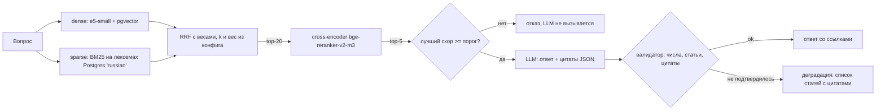

# Трудовой кодекс РФ: гибридный RAG с честной оценкой

[](https://github.com/DelixeamI/hybrid-rag/actions/workflows/ci.yml)
[](LICENSE)
[](pyproject.toml)
[](tests)

Сервис отвечает на вопросы по Трудовому кодексу обычным языком: коротко, со ссылками на статью, часть и цитату, либо честно отказывает, если в кодексе ответа нет. Главное в проекте не чат, а оценка: Recall@k, MRR, доля верных отказов и проверка, что каждое число в ответе есть в процитированном тексте.

> **Данные.** Текст ТК РФ лежит в `data/raw/`. Golden (`data/golden.jsonl`) сначала написала LLM, затем вручную проверил человек. Оценка на настоящем кодексе: [reports/results_full.md](reports/results_full.md). Для CI есть вторая, маленькая оценка на синтетической фикстуре (`tests/fixtures/`): она проверяет, что пайплайн не сломан, и о качестве ничего не говорит. Архитектурные решения: [DESIGN.md](DESIGN.md).

## Как это работает



Чанк = статья целиком (если короче ~500 токенов), длинные статьи режутся по частям с перекрытием в одну часть. У каждого чанка есть breadcrumbs: `ТК РФ > Глава 19. Отпуска > Статья 115. …`. Утратившие силу статьи не индексируются. Ингест идемпотентен по sha256 файла.

## Метрики

Таблицы генерирует `make eval`, из `reports/*.json` их копирует `scripts/update_readme.py`. Руками здесь не написано ни одной цифры.

### Настоящий кодекс

Ответы для настоящего кодекса сгенерировала локальная модель (`qwen2.5:14b` через Ollama), кассеты лежат в `tests/cassettes/full/`. Выборка небольшая: один вопрос двигает метрики на несколько процентов.

> Оценка сделана на проверенном человеком golden (76 вопросов с ответом и 16 без), одной моделью, без повторов и доверительных интервалов. Параметры гибрида подобраны на половине этих же вопросов (DESIGN D5), порог отказа на всех (DESIGN D7), поэтому числа оптимистичнее честной оценки на новых вопросах.

<!-- METRICS:START -->
Dataset `full`: 534 articles, 710 chunks, 92 questions (`golden.jsonl`). Full report: [reports/results_full.md](reports/results_full.md).

| Mode | Recall@1 | Recall@5 | Recall@10 | MRR | latency p50, ms | latency p95, ms |
|---|---|---|---|---|---|---|
| Postgres FTS (ts_rank_cd) | 21.1% | 42.1% | 50.0% | 0.287 | 9.2 | 122.1 |
| BM25 (Postgres lexemes) | 50.0% | 80.3% | 84.2% | 0.622 | 3.0 | 4.2 |
| dense (e5) | 75.0% | 84.2% | 92.1% | 0.795 | 20.5 | 27.4 |
| hybrid (dense + BM25, RRF) | 73.7% | 90.8% | 90.8% | 0.799 | 23.4 | 29.6 |
| hybrid + rerank | 86.8% | 93.4% | 94.7% | 0.898 | 404.1 | 466.3 |

LLM: `tkrag-qwen2.5-14b`; refusal threshold (reranker score): 0.0066

| Metric | Value | n |
|---|---|---|
| Correct refusals on `no_answer` | 100% | 16 |
| False refusals on answerable questions | 1.3% | 76 |
| `answer_facts` recall (answerable, refusals count as 0; prepositions ignored) | 73.9% | 76 |
| `answer_facts` recall, strict (also demands prepositions and conjunctions) | 71.9% | 76 |
| Answers with every number and article confirmed by citations | 92.0% | 75 |

Outcome statuses: ok=69, refused=17, unverified=6
<!-- METRICS:END -->

### Смоук-тест для CI (синтетическая фикстура)

Модель ответов здесь другая (Gemini), кассеты в `tests/cassettes/`. С таблицей выше эти числа сравнивать нельзя.

<!-- CI-METRICS:START -->
Dataset `fixture`: 20 articles, 20 chunks, 20 questions (`golden_fixture.jsonl`). Full report: [reports/results.md](reports/results.md).

| Mode | Recall@1 | Recall@5 | Recall@10 | MRR | latency p50, ms | latency p95, ms |
|---|---|---|---|---|---|---|
| Postgres FTS (ts_rank_cd) | 37.5% | 81.2% | 81.2% | 0.544 | 2.3 | 3.8 |
| BM25 (Postgres lexemes) | 56.2% | 81.2% | 81.2% | 0.640 | 1.1 | 1.8 |
| dense (e5) | 93.8% | 100% | 100% | 0.958 | 13.8 | 69.5 |
| hybrid (dense + BM25, RRF) | 81.2% | 87.5% | 100% | 0.850 | 14.8 | 25.7 |
| hybrid + rerank | 100% | 100% | 100% | 1.000 | 193.1 | 207.8 |

LLM: `gemini-3.8-flash`; refusal threshold (reranker score): 0.003

| Metric | Value | n |
|---|---|---|
| Correct refusals on `no_answer` | 100% | 4 |
| False refusals on answerable questions | 0% | 16 |
| `answer_facts` recall (answerable, refusals count as 0; prepositions ignored) | 100% | 16 |
| `answer_facts` recall, strict (also demands prepositions and conjunctions) | 100% | 16 |
| Answers with every number and article confirmed by citations | 100% | 16 |

Outcome statuses: ok=16, refused=4
<!-- CI-METRICS:END -->

## Запуск за минуту

Нужны Python 3.12, [uv](https://docs.astral.sh/uv/) и Docker; желательна видеокарта NVIDIA (reranker на CPU медленный). Ключи не нужны: LLM по умолчанию отвечает из записанных кассет. Сеть нужна один раз, чтобы скачать модели.

```bash
cp .env.example .env
uv sync
make up       # Postgres 16 + pgvector в docker compose
make ingest   # DATASET=fixture по умолчанию; DATASET=full для data/raw/
make eval     # отчёт в reports/, падает ниже порогов eval_thresholds.yaml
make demo     # поднимает API и задаёт 3 вопроса
```

Первый запуск скачивает модели Hugging Face (e5-small около 0,5 ГБ, reranker около 2,2 ГБ).

Без Docker (например, на Windows): `make local-pg` запускает встроенный Postgres 16 с pgvector и прописывает `DATABASE_URL` в `.env`.

Если нет `make` (Windows): каждая цель Makefile — это `uv run tkrag <команда>`.

### Команды

| Команда | Что делает |
|---|---|
| `make test` | юнит-тесты без БД, сети и моделей |
| `make test-all` | все тесты, включая тесты с Postgres |
| `make lint` | ruff + mypy --strict |
| `make ingest` | разбор, чанкинг, эмбеддинги, запись в БД |
| `make golden-check` | проверка golden: структура и квоты типов |
| `make calibrate` | лучший скор reranker по каждому вопросу и порог отказа |
| `make eval-retrieval` | Recall@k, MRR, p50/p95 по режимам fts, bm25, dense, hybrid, hybrid+rerank |
| `make eval` | retrieval + ответы на `RecordedLLM` + CI-гейт; `uv run tkrag eval --prune-cassettes` ещё удаляет кассеты, которые прогон не использовал |
| `make record` | то же на реальной LLM из `.env`, перезаписывает `tests/cassettes/` |
| `record --resume` | продолжает прерванную запись: готовые кассеты берёт, у модели спрашивает только про остальные (`uv run tkrag record --dataset full --resume`) |
| `make demo` | API + три вопроса из консоли |

### LLM

LLM спрятана за интерфейсом `LLMClient`: `FakeLLM` (тесты), `RecordedLLM` (кассеты, ключ sha256 от модели и промпта), `OpenAICompatibleLLM` (любой OpenAI-совместимый `base_url`: Ollama, Gemini, облако). Для реальной модели задай `LLM_MODE=openai`, `LLM_BASE_URL`, `LLM_MODEL`, `LLM_API_KEY` в `.env`. Изменился промпт, модель или состав найденных чанков: нужен `make record` (дозапись: `--resume`).

### Настоящий корпус и golden

1. Текст кодекса уже в `data/raw/tk_rf.txt` (скачан `scripts/fetch_corpus.py`, источник и дата в `data/raw/SOURCE.md`). Свой файл (`.txt` или `.html`) можно положить туда же.
2. Golden (`data/golden.jsonl`, 92 вопроса) проверен человеком. Для другого корпуса `uv run python scripts/draft_golden.py` предложит черновые вопросы (`data/golden.draft.jsonl`): проверь все строки вручную и сохрани как `data/golden.jsonl`. Путь можно задать переменной `GOLDEN_PATH`.
3. `make golden-check DATASET=full`, затем `make ingest eval-retrieval DATASET=full`. Отчёт: `reports/results_full.md`. Для `make eval DATASET=full` нужны ещё кассеты LLM (они лежат в `tests/cassettes/full/`, отдельно от фикстурных).

Как записаны кассеты для настоящего кодекса (локальный Ollama, без ключей и лимитов):

```bash
ollama create tkrag-qwen2.5-14b -f scripts/ollama/Modelfile   # qwen2.5:14b с контекстом 8192
export LLM_BASE_URL=http://localhost:11434/v1 LLM_MODEL=tkrag-qwen2.5-14b LLM_API_KEY=ollama
export REFUSAL_THRESHOLD=0.0066   # порог из `make calibrate DATASET=full`
make calibrate record DATASET=full     # запись кассет в tests/cassettes/full/
make eval DATASET=full                 # повтор с кассет, отчёт в reports/results_full.md
```

Метрики ответов по настоящему кодексу в [reports/results_full.md](reports/results_full.md) получены на другой модели, чем фикстурные, поэтому с таблицей смоук-теста их сравнивать нельзя.

### API

`POST /ask` с `{"question": "..."}` возвращает `{status, answer{answer, citations[{chunk_id, article, parts, quote}], refused, reason}, issues, best_score, timings_ms}`. Статусы: `ok`, `refused`, `unverified`. `GET /health` проверяет БД. Логи в JSON, с латентностью по этапам.

## Ограничения

- Одна редакция кодекса. Новая редакция заменяет старую целиком.
- Это не юридическая консультация. Нет подзаконных актов, судебной практики и других кодексов.
- Валидатор проверяет числа с единицами, номера статей и дословность цитат. Он не проверяет, что смысл ответа совпадает со смыслом статьи: для этого нужна оценка корректности ответов.
- Golden небольшой (92 вопроса): один вопрос двигает метрику на один-два процента, доверительных интервалов нет. Фикстура ещё меньше.
- Reranker (cross-encoder на 568M параметров) нужен GPU: на видеокарте задержка в `results_full.md` порядка долей секунды, на CPU при тех же данных была десятки секунд. `pyproject.toml` выбирает сборку torch по платформе: на Windows CUDA, на Linux CPU (для CI), на macOS wheel с PyPI. Linux с видеокартой: убери строку `linux` в `[tool.uv.sources]`.
- Параметры гибрида (k, вес dense) подобраны на половине вопросов. Разница с dense на второй половине в один-два вопроса, это в пределах шума ([reports/experiment_hybrid.md](reports/experiment_hybrid.md)). Прежнее ранжирование Postgres `ts_rank_cd` без IDF оставлено как режим `fts` для сравнения: оно заметно хуже.
- Текст кодекса взят с КонсультантПлюс, а не с официальной публикации; для юридически значимой работы сверяйся с pravo.gov.ru.

## Документы

[DESIGN.md](DESIGN.md) — подробные архитектурные решения, альтернативы и обоснования.
