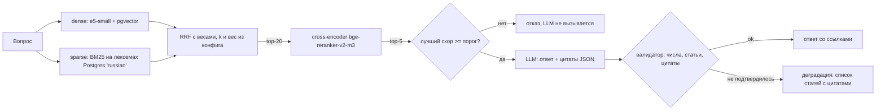

# Трудовой кодекс РФ: гибридный RAG с честной оценкой

[](https://github.com/DelixeamI/hybrid-rag/actions/workflows/ci.yml)
[](LICENSE)
[](pyproject.toml)
[](tests)

Сервис отвечает на вопросы по Трудовому кодексу обычным языком: коротко, со ссылками на статью, часть и цитату, либо честно отказывает, если в кодексе ответа нет. Главное в проекте не чат, а оценка: Recall@k, MRR, доля верных отказов и проверка, что каждое число в ответе есть в процитированном тексте.

> **Данные.** Текст ТК РФ лежит в `data/raw/`. Golden (`data/golden.jsonl`) сначала написала LLM, затем вручную проверил человек. Оценка на настоящем кодексе: [reports/results_full.md](reports/results_full.md). Для CI есть вторая, маленькая оценка на синтетической фикстуре (`tests/fixtures/`): она проверяет, что пайплайн не сломан, и о качестве ничего не говорит. Архитектурные решения: [DESIGN.md](DESIGN.md).

## Как это работает



Чанк = статья целиком (если короче ~500 токенов), длинные статьи режутся по частям с перекрытием в одну часть. У каждого чанка есть breadcrumbs: `ТК РФ > Глава 19. Отпуска > Статья 115. …`. Утратившие силу статьи не индексируются. Ингест идемпотентен по sha256 файла.

## Метрики

Таблицы генерирует `make eval`, из `reports/*.json` их копирует `scripts/update_readme.py`. Руками здесь не написано ни одной цифры.

**Как читать метрики.**

- **Recall@k и MRR** считаются по статьям. Если у вопроса несколько подходящих статей (`expected_articles` как альтернативы), он найден, когда в топ-k есть любая из них. Для вопросов типа `multi_article` нужны все указанные статьи: Recall@k там доля найденных, а MRR берётся по рангу последней нужной статьи (если какой-то нет, ноль). Найти только 115 из {115, 125} — это половина ответа, не успех.
- **«Подтверждённые ответы»** — это синтаксическая проверка (grounding): числа с единицами, номера статей и цитаты ответа есть в процитированном тексте. Это не доля юридически верных ответов: подтверждённый ответ может сделать неверный вывод из верной статьи. И считается она только среди ответов, которые система дала, а не среди всех вопросов.
- **`answer_facts` recall** — лексическое совпадение с ожидаемыми фактами (слова и числа после грубого стемминга), не оценка смысла.
- **Верные отказы** зависят от порога, подобранного на этом же golden. Честную оценку даёт только набор, по которому ничего не подбиралось: см. «Независимый test set».

### Настоящий кодекс

Ответы для настоящего кодекса сгенерировала локальная модель (`qwen2.5:14b` через Ollama), кассеты лежат в `tests/cassettes/full/`. Выборка небольшая: один вопрос двигает метрики на несколько процентов.

> Оценка сделана на проверенном человеком golden (76 вопросов с ответом и 16 без), одной моделью, без повторов и доверительных интервалов. Параметры гибрида подобраны на половине этих же вопросов (DESIGN D5), порог отказа на всех (DESIGN D7), поэтому числа оптимистичнее честной оценки на новых вопросах.

<!-- METRICS:START -->
Dataset `full`: 534 articles, 710 chunks, 92 questions (`golden.jsonl`). Full report: [reports/results_full.md](reports/results_full.md).

| Mode | Recall@1 | Recall@5 | Recall@10 | MRR | latency p50, ms | latency p95, ms |
|---|---|---|---|---|---|---|
| Postgres FTS (ts_rank_cd) | 19.7% | 39.5% | 46.1% | 0.251 | 10.8 | 139.3 |
| BM25 (Postgres lexemes) | 46.1% | 77.6% | 82.9% | 0.551 | 3.7 | 5.5 |
| dense (e5) | 69.1% | 80.3% | 88.8% | 0.696 | 23.4 | 31.2 |
| hybrid (dense + BM25, RRF) | 71.1% | 84.9% | 88.8% | 0.727 | 27.7 | 33.5 |
| hybrid + rerank | 80.3% | 90.8% | 92.8% | 0.816 | 397.6 | 476.2 |

LLM: `tkrag-qwen2.5-14b`; refusal threshold (reranker score): 0.0066

| Metric | Value | n |
|---|---|---|
| Correct refusals on `no_answer` | 100% | 16 |
| False refusals on answerable questions | 0% | 76 |
| `answer_facts` recall (answerable, refusals count as 0; prepositions ignored) | 73.2% | 76 |
| `answer_facts` recall, strict (also demands prepositions and conjunctions) | 71.3% | 76 |
| Grounded answers: numbers, articles and quotes are in the cited text (share of the answers given, not of all questions) | 93.4% | 76 |

Outcome statuses: ok=71, refused=16, unverified=5

**How to read these numbers.**

- *Grounded answers* is a syntactic check: the numbers with units, the article numbers and the quotes of the answer occur in the cited fragments. It is not the share of legally correct answers; a grounded answer can still draw a wrong conclusion from the right article. It also counts only the answers that were given.
- *`answer_facts` recall* is lexical overlap with the expected facts (words and numbers after a crude stemming). It misses a correct answer in other words and can accept a wrong answer that contains the same words.
- *Correct refusals* depend on a threshold that was chosen on this same golden set, so they are optimistic for new questions. Only a set that was not used to choose any parameter or threshold gives an honest estimate (see `eval --frozen` in the README).
<!-- METRICS:END -->

### Смоук-тест для CI (синтетическая фикстура)

Модель ответов здесь другая (Gemini), кассеты в `tests/cassettes/`. С таблицей выше эти числа сравнивать нельзя.

<!-- CI-METRICS:START -->
Dataset `fixture`: 20 articles, 20 chunks, 20 questions (`golden_fixture.jsonl`). Full report: [reports/results.md](reports/results.md).

| Mode | Recall@1 | Recall@5 | Recall@10 | MRR | latency p50, ms | latency p95, ms |
|---|---|---|---|---|---|---|
| Postgres FTS (ts_rank_cd) | 28.1% | 78.1% | 78.1% | 0.390 | 0.9 | 3.0 |
| BM25 (Postgres lexemes) | 50.0% | 78.1% | 81.2% | 0.567 | 0.6 | 0.8 |
| dense (e5) | 84.4% | 96.9% | 100% | 0.844 | 12.2 | 90.0 |
| hybrid (dense + BM25, RRF) | 78.1% | 96.9% | 100% | 0.802 | 12.4 | 16.4 |
| hybrid + rerank | 90.6% | 100% | 100% | 0.896 | 186.1 | 202.8 |

LLM: `gemini-3.8-flash`; refusal threshold (reranker score): 0.003

| Metric | Value | n |
|---|---|---|
| Correct refusals on `no_answer` | 100% | 4 |
| False refusals on answerable questions | 0% | 16 |
| `answer_facts` recall (answerable, refusals count as 0; prepositions ignored) | 100% | 16 |
| `answer_facts` recall, strict (also demands prepositions and conjunctions) | 100% | 16 |
| Grounded answers: numbers, articles and quotes are in the cited text (share of the answers given, not of all questions) | 100% | 16 |

Outcome statuses: ok=16, refused=4

**How to read these numbers.**

- *Grounded answers* is a syntactic check: the numbers with units, the article numbers and the quotes of the answer occur in the cited fragments. It is not the share of legally correct answers; a grounded answer can still draw a wrong conclusion from the right article. It also counts only the answers that were given.
- *`answer_facts` recall* is lexical overlap with the expected facts (words and numbers after a crude stemming). It misses a correct answer in other words and can accept a wrong answer that contains the same words.
- *Correct refusals* depend on a threshold that was chosen on this same golden set, so they are optimistic for new questions. Only a set that was not used to choose any parameter or threshold gives an honest estimate (see `eval --frozen` in the README).
<!-- CI-METRICS:END -->

## Запуск за минуту

Нужны Python 3.12, [uv](https://docs.astral.sh/uv/) и Docker; желательна видеокарта NVIDIA (reranker на CPU медленный). Ключи не нужны: LLM по умолчанию отвечает из записанных кассет. Сеть нужна один раз, чтобы скачать модели.

```bash
cp .env.example .env
uv sync
make up       # Postgres 16 + pgvector в docker compose
make ingest   # DATASET=fixture по умолчанию; DATASET=full для data/raw/
make eval     # отчёт в reports/, падает ниже порогов eval_thresholds.yaml
make demo     # поднимает API и задаёт 3 вопроса
```

Первый запуск скачивает модели Hugging Face (e5-small около 0,5 ГБ, reranker около 2,2 ГБ).

Без Docker (например, на Windows): `make local-pg` запускает встроенный Postgres 16 с pgvector и прописывает `DATABASE_URL` в `.env`.

Если нет `make` (Windows): каждая цель Makefile — это `uv run tkrag <команда>`.

### Команды

| Команда | Что делает |
|---|---|
| `make test` | юнит-тесты без БД, сети и моделей |
| `make test-all` | все тесты, включая тесты с Postgres |
| `make lint` | ruff + mypy --strict |
| `make ingest` | разбор, чанкинг, эмбеддинги, запись в БД |
| `make golden-check` | проверка golden: структура и квоты типов |
| `make calibrate` | лучший скор reranker по каждому вопросу и порог отказа |
| `make eval-retrieval` | Recall@k, MRR, p50/p95 по режимам fts, bm25, dense, hybrid, hybrid+rerank |
| `make eval` | retrieval + ответы на `RecordedLLM` + CI-гейт; `uv run tkrag eval --prune-cassettes` ещё удаляет кассеты, которые прогон не использовал |
| `make record` | то же на реальной LLM из `.env`, перезаписывает `tests/cassettes/` |
| `record --resume` | продолжает прерванную запись: готовые кассеты берёт, у модели спрашивает только про остальные (`uv run tkrag record --dataset full --resume`) |
| `make demo` | API + три вопроса из консоли |

### LLM

LLM спрятана за интерфейсом `LLMClient`: `FakeLLM` (тесты), `RecordedLLM` (кассеты, ключ sha256 от модели и промпта), `OpenAICompatibleLLM` (любой OpenAI-совместимый `base_url`: Ollama, Gemini, облако). Для реальной модели задай `LLM_MODE=openai`, `LLM_BASE_URL`, `LLM_MODEL`, `LLM_API_KEY` в `.env`. Изменился промпт, модель или состав найденных чанков: нужен `make record` (дозапись: `--resume`).

### Настоящий корпус и golden

1. Текст кодекса уже в `data/raw/tk_rf.txt` (скачан `scripts/fetch_corpus.py`, источник и дата в `data/raw/SOURCE.md`). Свой файл (`.txt` или `.html`) можно положить туда же.
2. Golden (`data/golden.jsonl`, 92 вопроса) проверен человеком. Для другого корпуса `uv run python scripts/draft_golden.py` предложит черновые вопросы (`data/golden.draft.jsonl`): проверь все строки вручную и сохрани как `data/golden.jsonl`. Путь можно задать переменной `GOLDEN_PATH`.
3. `make golden-check DATASET=full`, затем `make ingest eval-retrieval DATASET=full`. Отчёт: `reports/results_full.md`. Для `make eval DATASET=full` нужны ещё кассеты LLM (они лежат в `tests/cassettes/full/`, отдельно от фикстурных).

Как записаны кассеты для настоящего кодекса (локальный Ollama, без ключей и лимитов):

```bash
ollama create tkrag-qwen2.5-14b -f scripts/ollama/Modelfile   # qwen2.5:14b с контекстом 8192
export LLM_BASE_URL=http://localhost:11434/v1 LLM_MODEL=tkrag-qwen2.5-14b LLM_API_KEY=ollama
export REFUSAL_THRESHOLD=0.0066   # порог из `make calibrate DATASET=full`
make calibrate record DATASET=full     # запись кассет в tests/cassettes/full/
make eval DATASET=full                 # повтор с кассет, отчёт в reports/results_full.md
```

Метрики ответов по настоящему кодексу в [reports/results_full.md](reports/results_full.md) получены на другой модели, чем фикстурные, поэтому с таблицей смоук-теста их сравнивать нельзя.

### Независимый test set

Параметры гибрида (k, вес dense) и порог отказа подобраны на `data/golden.jsonl`, поэтому метрики на нём оптимистичны. Чтобы получить честную оценку, нужен второй набор, который не использовался ни для выбора параметров, ни для порога (рекомендуется 100–200 вопросов). Заготовка процесса:

1. Черновик по статьям, которых нет в первом наборе (нужна LLM; например, локальный Ollama):

   ```bash
   uv run python scripts/draft_golden.py --exclude data/golden.jsonl --out data/golden_test.draft.jsonl --clusters 20 --pairs 20 --no-answer 30 --seed 21
   ```

2. Проверь все строки вручную, как для первого набора, и сохрани как `data/golden_test.jsonl`.
3. Проверка структуры и повторов вопросов относительно первого набора:

   ```bash
   uv run tkrag golden-check --dataset full --golden data/golden_test.jsonl --against data/golden.jsonl
   ```

4. Запись кассет и оценка с зафиксированными параметрами (никаких подборов после просмотра результата):

   ```bash
   uv run tkrag record --dataset full --golden data/golden_test.jsonl --stem results_test --frozen
   ```

   ```bash
   uv run tkrag eval --dataset full --golden data/golden_test.jsonl --stem results_test --frozen
   ```

Отчёт попадёт в `reports/results_test.md` с пометкой «frozen test set» и без калибровки порога. Если результат плох, это и есть результат: параметры после этого можно менять только вместе с новым, ещё не использованным тестовым набором.

### API

`POST /ask` с `{"question": "..."}` возвращает `{status, answer{answer, citations[{chunk_id, article, parts, quote}], refused, reason}, issues, best_score, timings_ms}`. Статусы: `ok`, `refused`, `unverified`. `GET /health` проверяет БД. Логи в JSON, с латентностью по этапам.

## Ограничения

- Одна редакция кодекса. Новая редакция заменяет старую целиком.
- Это не юридическая консультация. Нет подзаконных актов, судебной практики и других кодексов.
- Валидатор проверяет числа с единицами, номера статей и дословность цитат. Он не проверяет, что смысл ответа совпадает со смыслом статьи: для этого нужна оценка корректности ответов.
- Golden небольшой (92 вопроса): один вопрос двигает метрику на один-два процента, доверительных интервалов нет. Фикстура ещё меньше.
- Reranker (cross-encoder на 568M параметров) нужен GPU: на видеокарте задержка в `results_full.md` порядка долей секунды, на CPU при тех же данных была десятки секунд. `pyproject.toml` выбирает сборку torch по платформе: на Windows CUDA, на Linux CPU (для CI), на macOS wheel с PyPI. Linux с видеокартой: убери строку `linux` в `[tool.uv.sources]`.
- Параметры гибрида (k, вес dense) подобраны на половине вопросов. Разница с dense на второй половине в один-два вопроса, это в пределах шума ([reports/experiment_hybrid.md](reports/experiment_hybrid.md)). Прежнее ранжирование Postgres `ts_rank_cd` без IDF оставлено как режим `fts` для сравнения: оно заметно хуже.
- Текст кодекса взят с КонсультантПлюс, а не с официальной публикации; для юридически значимой работы сверяйся с pravo.gov.ru.

## Документы

[DESIGN.md](DESIGN.md) — подробные архитектурные решения, альтернативы и обоснования.
